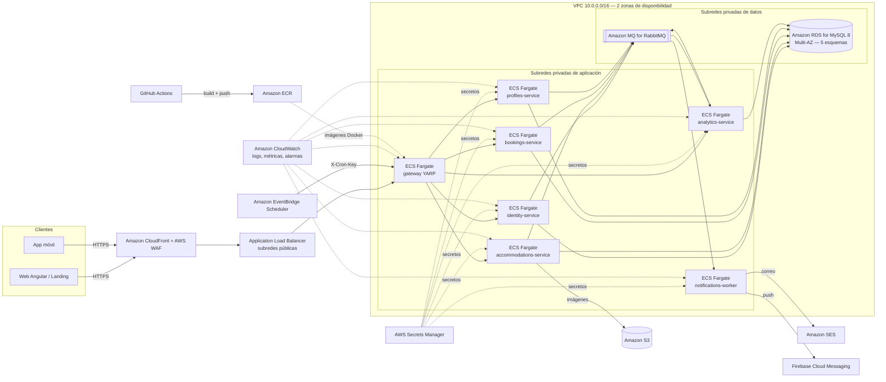

# Arquitectura cloud de RoomTrack en AWS (borrador para la sección 5.4.1)

Borrador técnico para el *Cloud Architecture Diagram* que pide la retroalimentación del Avance 4 (criterio 4): un
proveedor concreto (AWS, según CON-02) con sus servicios, mapeado a los componentes reales de `render.yaml` y
`docker-compose.yml`. Hoy el sistema corre en Render (plan gratuito); este es el despliegue objetivo del TF1.

## Diagrama

## Componentes y mapeo con el despliegue actual

| Componente AWS | Rol | Hoy (Render / Compose) |
|---|---|---|
| Amazon CloudFront + AWS WAF | Entrada HTTPS, caché de `/docs`, protección OWASP y rate limiting perimetral | Dominio `onrender.com` |
| Application Load Balancer | Termina TLS y reparte entre tareas del gateway (health check `/health`) | Balanceador de Render |
| ECS Fargate (7 servicios) | Un *service* de ECS por contenedor, con autoescalado por CPU/peticiones; `notifications-worker` sin puerto público | Un *web service* por componente en `render.yaml` |
| API Gateway (patrón) | El gateway YARP sigue siendo el API Gateway del sistema (enrutamiento, CORS, Swagger unificado); el ALB solo lo expone | `roomtrack-gateway` |
| Amazon RDS for MySQL 8 (Multi-AZ) | Una instancia con un esquema y un usuario por servicio (`roomtrack_identity`, `_accommodations`, `_bookings`, `_profiles`, `_analytics`), copias automáticas | MySQL de Aiven / `deploy/mysql/init` |
| Amazon MQ for RabbitMQ | Broker de MassTransit: eventos de integración, `SendEmail`, `DeliverPushNotification` | RabbitMQ (CloudAMQP / Compose) |
| Amazon SES | Transporte de correo del worker (reemplaza Brevo/SMTP sin cambiar código: transporte SMTP) | Brevo |
| Amazon S3 | Imágenes de hoteles (hoy en Cloudinary) | Cloudinary |
| Amazon EventBridge Scheduler | Dispara los jobs (`/bookings/expire-pending`, `/incidents/escalations`, `/preventive-maintenance-plans/runs`, …) con `X-Cron-Key` | GitHub Actions `scheduler.yml` |
| AWS Secrets Manager | `ConnectionStrings__DefaultConnection`, `TokenSettings__Secret`, `Internal__ApiKey`, `Cron__ApiKey`, credenciales de FCM | Variables de entorno de Render |
| Amazon CloudWatch | Logs de los contenedores, métricas (latencia, 5xx, profundidad de colas) y alarmas | Logs de Render |
| Amazon ECR + GitHub Actions | Registro de imágenes; `docker-publish.yml` publica y ECS hace *rolling update* | `Dockerfile` + despliegue de Render |
| IAM | Un *task role* por servicio con el mínimo privilegio (solo su secreto, su bucket, sus colas) | — |

## Red y seguridad

- **VPC** con 2 zonas de disponibilidad: subredes públicas (ALB, NAT Gateway), privadas de aplicación (ECS) y privadas
  de datos (RDS, Amazon MQ). Solo el ALB es accesible desde Internet.
- **Security groups:** ALB → gateway (8080); gateway → servicios (8080); servicios → RDS (3306) y Amazon MQ (5671);
  la API interna `/internal/v1` solo es alcanzable dentro de la VPC (además de exigir `X-Internal-Key`).
- **Descubrimiento de servicios:** AWS Cloud Map (`identity.roomtrack.local`, …), que reemplaza las URLs de
  `Services__*__BaseUrl` y `ReverseProxy__Clusters__*`.

## Escalabilidad y disponibilidad (atributos de calidad)

- Autoescalado de ECS por servicio (p. ej. `bookings-service` 2-6 tareas en hora punta de check-in/check-out).
- RDS Multi-AZ y Amazon MQ en modo cluster: tolerancia a la caída de una zona.
- Las notificaciones no bloquean las peticiones: el outbox de MassTransit garantiza la entrega aunque el worker o el
  proveedor estén caídos (reintentos con backoff).
