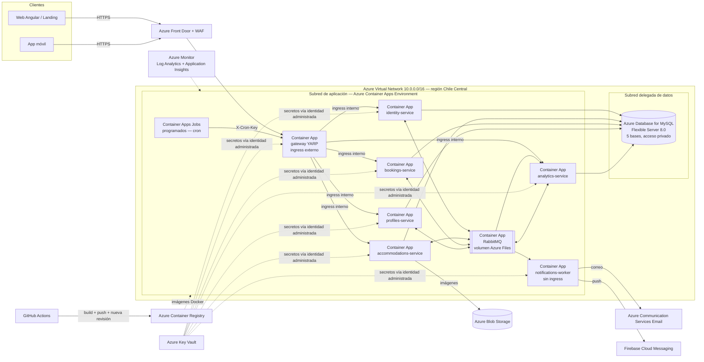

# Arquitectura cloud de RoomTrack en Microsoft Azure (borrador para la sección 5.4.1)

Borrador técnico del *Cloud Architecture Diagram* que pide la retroalimentación del Avance 4 (criterio 4): un proveedor
concreto de los permitidos por CON-02 (AWS, Azure o Google Cloud) con sus servicios, mapeado a los componentes reales
de `render.yaml` y `docker-compose.yml`. Se elige **Microsoft Azure** porque Azure for Students ofrece crédito sin
tarjeta y Azure Container Apps ejecuta los mismos contenedores Docker que hoy corren en Render, sin cambiar el código.
Hoy el sistema corre en Render (plan gratuito); este es el despliegue objetivo del TF1.

## Diagrama



## Componentes y mapeo con el despliegue actual

| Componente Azure | Rol | Hoy (Render / Compose) |
|---|---|---|
| Azure Front Door + WAF | Entrada HTTPS global, dominio propio, reglas OWASP y rate limiting perimetral | Dominio `onrender.com` |
| Azure Container Apps Environment | Plataforma de contenedores administrada (sobre Kubernetes) integrada en la VNet; balanceo, TLS y descubrimiento de servicios incluidos | Plataforma de Render |
| Container Apps (7) | Una app por contenedor: `gateway` con ingress **externo**, los 5 servicios con ingress **interno** (solo visibles dentro del entorno) y el worker sin ingress. Cada despliegue crea una revisión nueva (rollback inmediato) | Un *web service* por componente en `render.yaml` |
| API Gateway (patrón) | El gateway YARP sigue siendo el API Gateway del sistema (enrutamiento, CORS, Swagger unificado); Front Door solo lo expone | `roomtrack-gateway` |
| Azure Database for MySQL – Flexible Server 8.0 | Un servidor con una base y un usuario por servicio (`roomtrack_identity`, `_accommodations`, `_bookings`, `_profiles`, `_analytics`), acceso privado por la subred delegada, SSL obligatorio, copias automáticas | MySQL de Aiven / `deploy/mysql/init` |
| RabbitMQ en Container Apps (volumen Azure Files) | Broker de MassTransit: eventos de integración, `SendEmail`, `DeliverPushNotification`. Azure no ofrece RabbitMQ administrado; alternativa sin cambios: seguir con CloudAMQP; alternativa nativa: Azure Service Bus (MassTransit lo soporta cambiando solo la configuración de transporte) | RabbitMQ (CloudAMQP / Compose) |
| Azure Communication Services Email | Transporte de correo del worker por SMTP (sin cambiar código) | Brevo |
| Azure Blob Storage | Imágenes de hoteles | Cloudinary |
| Container Apps Jobs (programados) | Disparan los jobs con `X-Cron-Key`: `/bookings/expire-pending`, `/rooms/maintenance-alerts`, `/incidents/escalations`, `/preventive-maintenance-plans/runs`, `/staff-performance/report-schedules/runs`, `/demo-requests/follow-ups` | GitHub Actions `scheduler.yml` |
| Azure Key Vault + identidad administrada | `ConnectionStrings__DefaultConnection`, `TokenSettings__Secret`, `Internal__ApiKey`, `Cron__ApiKey`, credenciales de FCM; cada app lee solo sus secretos, sin contraseñas en variables | Variables de entorno de Render |
| Azure Monitor (Log Analytics + Application Insights) | Logs de los contenedores, trazas distribuidas entre servicios, métricas (latencia, 5xx, longitud de colas) y alertas | Logs de Render |
| Azure Container Registry + GitHub Actions | Registro de imágenes; `docker-publish.yml` publica y Container Apps despliega la revisión nueva | `Dockerfile` + despliegue de Render |
| Microsoft Entra ID (RBAC de Azure) | Permisos mínimos por identidad administrada (su secreto, su contenedor de Blob) | — |

## Red y seguridad

- **VNet** con dos subredes: la del Container Apps Environment (aplicaciones, RabbitMQ y jobs) y una subred delegada a
  MySQL Flexible Server. Solo el gateway tiene ingress externo, y solo Front Door llega a él.
- **Ingress interno:** los servicios se llaman por su nombre dentro del entorno (`http://identity-service`,
  `http://bookings-service`…), que reemplaza las URLs de `Services__*__BaseUrl` y `ReverseProxy__Clusters__*`. La API
  interna `/internal/v1` no es alcanzable desde Internet (además de exigir `X-Internal-Key`).
- **MySQL** sin acceso público, con SSL obligatorio (`SslMode=Required` en la cadena de conexión).

## Escalabilidad y disponibilidad (atributos de calidad)

- **Autoescalado con reglas KEDA** por app: los servicios por concurrencia HTTP (p. ej. `bookings-service` de 1 a 6
  réplicas en la hora punta de check-in/check-out) y el `notifications-worker` por longitud de la cola de RabbitMQ.
- **Disponibilidad:** entorno de Container Apps con redundancia de zona y MySQL Flexible Server con alta disponibilidad
  *zone-redundant* en producción (en el plan de estudiante, un servidor *Burstable B1ms* sin alta disponibilidad).
- Las notificaciones no bloquean las peticiones: el outbox de MassTransit garantiza la entrega aunque el worker o el
  proveedor estén caídos (reintentos con backoff).

## Portabilidad (AC-08)

Los servicios siguen siendo contenedores Docker con configuración externalizada y MySQL estándar: el mismo diseño se
traslada a AWS (ECS Fargate, RDS for MySQL, Amazon MQ) o a Google Cloud (Cloud Run, Cloud SQL) cambiando solo la
infraestructura, no el código.

## Despliegue con Azure for Students (`deploy/azure/deploy.ps1`)

La suscripción Azure for Students de la UPC solo permite las regiones `westus3`, `mexicocentral`, `southcentralus`,
`canadacentral` y `chilecentral`; se usa **Chile Central**, la más cercana a Lima. Para no agotar el crédito, el
despliegue real es un subconjunto del diagrama: Container Apps (plan de consumo, ingress externo solo en el gateway,
`identity-service`, `analytics-service` y el worker con 1 réplica porque consumen RabbitMQ, el resto escala a cero),
MySQL Flexible Server *Burstable B1ms* con acceso solo desde servicios de Azure y TLS obligatorio, y Log Analytics.
Front Door, la VNet privada, Key Vault y ACR se dejan para producción; RabbitMQ (CloudAMQP), Brevo y Cloudinary siguen
siendo externos, y las imágenes se descargan de GHCR.

```powershell
Copy-Item deploy\azure\roomtrack.azure.env.example deploy\azure\roomtrack.azure.env   # y completar los REQUIRED
az login
.\deploy\azure\deploy.ps1                 # crea o actualiza todo (idempotente)
.\deploy\azure\deploy.ps1 -UpdateImages   # nueva revisión de cada app tras publicar imágenes
```
